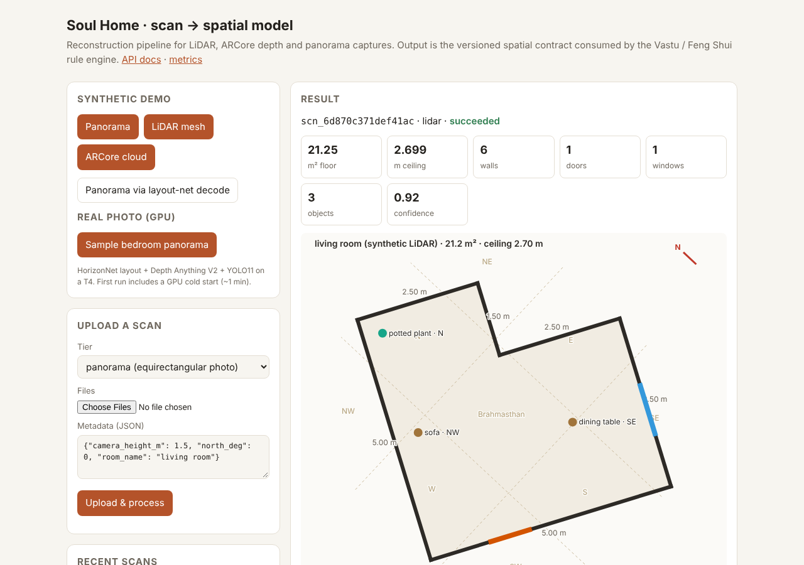
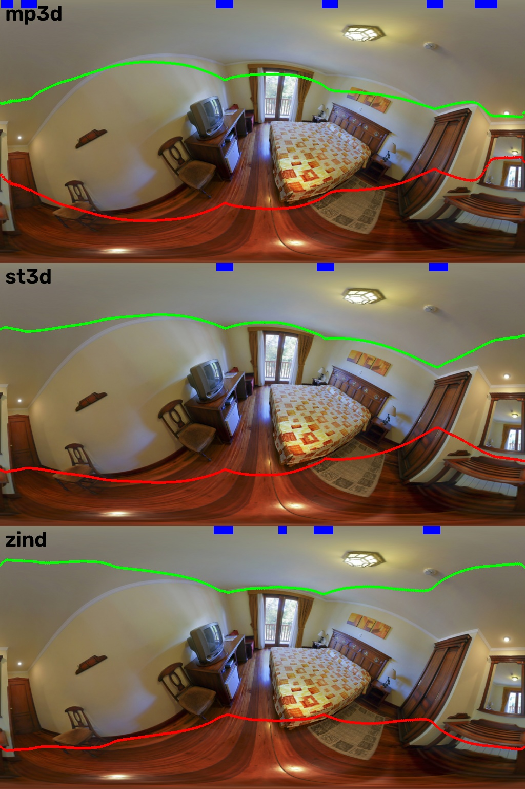
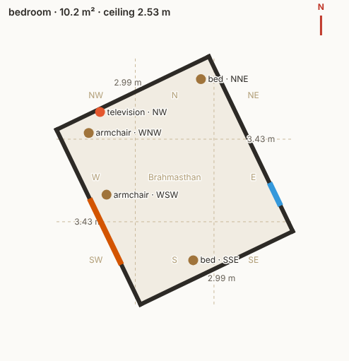

# Soul Home: scan → structured spatial model

This is the server-side reconstruction pipeline for a home-capture app. It covers everything that happens **after upload**. Input is a scan from one of three capture tiers. Output is a versioned, metric **spatial data contract** that a deterministic Vastu / Feng Shui rule engine can consume: rooms, walls, doors and windows, placed objects, and compass zones.

| Tier | Input | How the geometry is recovered |
|---|---|---|
| **LiDAR** (iOS) | USDZ / GLB / PLY / OBJ mesh | cleanup → decimation → surface sampling → gravity + unit normalisation → floor-occupancy footprint → Manhattan regularisation → wall refit → opening detection |
| **ARCore depth** (Android) | fused point cloud (PLY) or mesh | Y-up → Z-up, voxel downsample, then the same geometry stages |
| **Panorama fallback** | equirectangular photo | **HorizonNet** layout (official MP3D weights) → metric polygon from camera height; **Depth Anything V2** (metric indoor) depth fused to the layout; **YOLO11** detections back-projected into room coordinates |

All three tiers produce the same contract, in the same frame: metres, +Z up, floor at z = 0, and `north_deg` = compass bearing of +Y.



## What's in the box

```
soulhome/
  contract.py              versioned SpatialModel (semver, pydantic) consumed by the rule engine
  geometry/
    equirect.py            equirect ↔ spherical ↔ pinhole projection math
    planes.py              RANSAC planes, gravity alignment, Manhattan yaw (histogram entropy)
    polygon.py             Douglas-Peucker + Manhattan regularisation into clean wall vectors
    floorplan.py           footprint (viewpoint sweep / floor occupancy), wall refit, door/window gaps
    fusion.py              per-azimuth rescaling of monocular depth onto the layout-net walls
  layout/
    horizonnet.py          decode HorizonNet/LGT-Net 1D outputs → metric Manhattan polygon
    horizonnet_model.py    vendored HorizonNet (MIT) + safe checkpoint loading from the HF Hub
  inference/models.py      GPU models: HorizonNet, Depth Anything V2, YOLO11 (tiled over the pano)
  mesh/processing.py       USD/USDZ/GLB/PLY/OBJ loading, unit detection, cleanup, decimation
  objects/                 76-entry object catalog, 2D→3D back-projection, cross-tile NMS
  spatial/                 16-direction + 3×3 Vastu grid zone queries, SVG floor plans
  pipeline/                stage runner (timing, structured logs, typed retryable/fatal errors),
                           per-tier orchestration, validation gates, confidence scoring
  service/                 FastAPI app, job store (idempotency, state machine, metrics), worker
modal_app.py               Modal deployment (API + CPU workers + GPU inference class)
db/schema.sql              PostgreSQL 16 + PostGIS layout for the AWS target
tests/                     39 tests: geometry units, per-tier regression suite, API/queue behaviour,
                           opt-in real-model test
```

## Design notes

**Silent geometric errors fail the job instead of shipping.** `pipeline/assemble.py` applies hard gates: the polygon must be valid, area must be in [1.5, 300] m², ceiling in [1.9, 6] m, there must be at least 4 walls, and no wall can be degenerate. A scan that fails a gate is dead-lettered with a stage and an error code. A bad model never reaches the rule engine. Softer issues are kept as warnings and lower the `quality.confidence` score. Examples: an opening that runs past its wall, no door found, or depth that disagrees with the layout.

**Retry vs dead-letter is decided per error.** Every stage runs inside `StageRecorder`, which turns exceptions into a `PipelineError(stage, code, retryable)`:
- Transient faults (timeouts, OOM, IO) are retried with backoff. On Modal this uses `modal.Retries`.
- Deterministic failures, such as bad input or invalid geometry, go straight to `failed`. That way no GPU time is spent on a scan that can never succeed.
- `POST /v1/scans/{id}/redrive` re-queues a dead-lettered scan once a fix is deployed.
- Duplicate deliveries of a finished job are no-ops.

**Idempotent uploads.** Clients on flaky mobile networks retry, so `Idempotency-Key` + a request hash are reserved atomically (`modal.Dict.put(skip_if_exists=True)` here, `UNIQUE (user_id, idempotency_key)` in Postgres):
- A retry with the same key and the same payload returns the original job.
- The same key with a different payload returns `409`.

**Panorama tier: layout first, depth second.** Monocular metric depth looks right but is not planar-consistent across a wide field of view. On a real bedroom, the straight-down cube face read the floor as ~3.7 m away. So the pipeline uses the networks for what each is good at:
- **HorizonNet** gives metric walls from the floor/ceiling boundary latitudes and the camera height.
- **Depth Anything V2** runs on two overlapping pitched rings of perspective views, and every ray is rescaled by a smooth per-azimuth factor so the upper wall band lands on the layout walls (`geometry/fusion.py`). The low-quantile band estimate ignores see-through door and window pixels.
- The fused depth then drives opening detection and object placement.

If no layout net is available, a depth-only path takes over: it fits the floor, estimates camera height and sweeps the walls.

The three official checkpoints were compared on a real panorama. MP3D tracks the true wall junctions best and is the default:



**Openings are see-through gaps, not missing points.** A wall cell counts as open only when it has no on-wall points **and** there is geometry behind the wall plane. This stops a sofa in front of a wall from being read as a doorway. It also lets windows be found when furniture hides the sill.

**Objects.**
- On panoramas, YOLO11 runs on six overlapping perspective tiles. Boxes are projected back to equirectangular coordinates, with seam handling, then de-duplicated with IoU + containment NMS. Containment matters because a tile edge cuts an object into a partial box.
- Each box is placed by the median of its fused-depth points (`depth_median`), or by intersecting its bottom-centre ray with the floor (`floor_ray`). The placement is pushed back by half the catalog depth, because the visible edge is the front of the object.
- AR tiers accept either RoomPlan-style 3D boxes or 2D boxes with camera poses (OpenCV or ARKit convention). They follow the same 4×4 normalisation transform as the mesh.
- The COCO-pretrained YOLO11 maps onto the 76-entry catalog. Entries with `coco=None` need the custom-trained 76-class model, which drops in via `SOULHOME_YOLO_WEIGHTS`.

**Spatial contract & zones.** Each object gets a 16-direction bearing from the room centroid and a 3×3 Vastu grid cell (with Brahmasthan as the centre cell). Walls carry the bearing of their inward normal. `GET /v1/scans/{id}/zones?system=16|8|grid` groups objects and openings by zone. `db/schema.sql` shows the same data as PostGIS tables, so the rule engine can also query it in SQL.

## Results

The regression suite renders one analytic L-shaped room (21.25 m², 2.70 m ceiling, one door, one window, three objects) through every tier:

| Path | Area | Ceiling | Walls | Openings | Notes |
|---|---|---|---|---|---|
| Panorama, depth only | 21.25 m² | 2.700 m | 6 | door 0.90 × 2.05, window 1.20 @ 0.90 sill | objects within 0.3 m |
| Panorama, layout decode + fused depth | 21.25 m² | 2.700 m | 6 | same | |
| LiDAR mesh (noisy, Y-up, rotated 17°, floating fragments) | 21.25 m² | 2.699 m | 6 | door 0.90, window 1.10 | fragments removed |
| ARCore point cloud | 21.25 m² | 2.699 m | 6 | door 0.90, window 1.20 | |
| PLY in millimetres / USD in centimetres | ±2% | | | | units auto-detected |

On a **real** bedroom panorama (the HorizonNet sample image), the run produced a 10.25 m² room with a 2.53 m ceiling and 4 walls. It found a door and a window, plus bed, TV and two chairs, each in its Vastu zone. Times on CPU: layout 1.9 s, depth 12.4 s (16 views), detection 1.1 s. On a T4 the whole GPU part takes a few seconds.



## API

| Method | Path | |
|---|---|---|
| `POST` | `/v1/scans` | multipart: `tier`, `metadata` (JSON), `files[]`; header `Idempotency-Key` → `202` + status links |
| `GET` | `/v1/scans/{id}` | status, current stage, attempts, typed error, `Retry-After` while running |
| `GET` | `/v1/scans/{id}/model` | the SpatialModel (schema 1.0.0) |
| `GET` | `/v1/scans/{id}/floorplan.svg` · `/mesh.glb` · `/zones` | artifacts and zone queries |
| `POST` | `/v1/scans/{id}/redrive` | re-queue a dead-lettered scan |
| `POST` | `/v1/demo/{panorama,lidar,arcore}` | synthetic scan (no GPU) |
| `POST` | `/v1/demo/panorama-photo` | real panorama through the GPU models |
| `GET` | `/v1/metrics` | counts by status/tier, failures by stage/code, per-stage p50/p95 latency |

`ScanMeta` fields: `camera_height_m`, `north_deg`, `room_name`, `up_axis` (`y`/`z`), `units` (`m`/`cm`/`mm`/`in`/`ft`), `layout_backend` (`auto`/`horizonnet`/`depth`).

## Run it

```bash
pip install -e ".[dev,usd]"
pytest                                    # 38 tests (+1 opt-in), ~12 s, CPU only
SOULHOME_MODEL_TESTS=1 pytest tests/test_real_models.py   # real models (needs .[ml])
python -m soulhome.service.local          # http://localhost:8000 (set SOULHOME_LOCAL_MODELS=1 for GPU models)
```

### Deploy on Modal

```bash
pip install modal && modal setup          # or export MODAL_TOKEN_ID / MODAL_TOKEN_SECRET
modal deploy modal_app.py                 # prints https://<workspace>--soulhome-api.modal.run
modal run modal_app.py --tier lidar       # smoke test through the worker path
python scripts/submit.py https://<workspace>--soulhome-api.modal.run panorama my_room.jpg --north 30 --height 1.5
```

Modal topology:
- **`api`**: ASGI on CPU, scales to zero.
- **`process_scan`**: CPU worker using `modal.Retries`.
- **`Inference`**: a T4 GPU class. Models load once per container, weights are cached on a Volume, and it scales to zero after 2 idle minutes. It is only called for real panorama uploads. Mesh tiers and synthetic demos never start a GPU.

Storage:
- Uploads and versioned results live on the `soulhome-scans` Volume: `scans/<id>/input/` and `scans/<id>/results/v<pipeline>/`.
- Job state lives in the `soulhome-jobs` Dict.

CI (`.github/workflows/ci.yml`) runs the tests on every push. It deploys from `main` once the `MODAL_TOKEN_ID` / `MODAL_TOKEN_SECRET` repo secrets are set.

### Mapping to AWS

The storage and queue are behind interfaces (`KV`, `ArtifactStore`, `dispatch`), so moving to AWS means swapping adapters, not rewriting:

| Here | AWS equivalent |
|---|---|
| Modal Dict | RDS PostgreSQL 16 (`db/schema.sql`) |
| Modal Volume | S3, same prefixes, with lifecycle rules |
| `process_scan.spawn` + `modal.Retries` | SQS with a redrive policy / DLQ |
| `Inference` class | GPU EC2 / ECS behind the same three methods |

## Credits

HorizonNet architecture and weights: Sun et al., CVPR 2019 ([code](https://github.com/sunset1995/HorizonNet), MIT; weights from `sunset1995/HorizonNet` on the HF Hub). The sample panorama used in the demo and docs comes from the same repository. Depth Anything V2 (Yang et al., 2024). YOLO11 (Ultralytics, AGPL-3.0; replace it with a commercially licensed detector for closed-source use).
